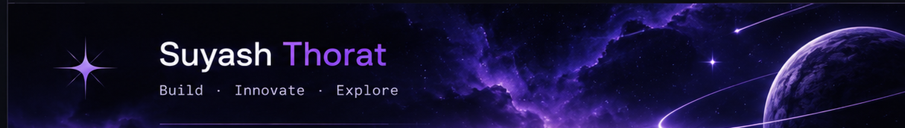

  

<h2 align="center">Hey, I'm Suyash 👋</h2>

  <strong>Information Technology Undergraduate · AI/ML Enthusiast · Full-Stack Developer</strong>
   
  Exploring intelligent systems, building useful products, and turning ideas into working software.
    
  <a href="https://www.linkedin.com/in/suyashh9137/">LinkedIn</a>
  ·
  <a href="https://github.com/suyash9137">GitHub</a>

---

## About

I'm an Information Technology undergraduate at **Vasantdada Patil College of Engineering, Mumbai**. I enjoy working across the software stack — from building interfaces and web applications to exploring data, machine learning, and practical AI tools.

- 🎓 BTech in Information Technology
- 🧠 Interested in AI/ML, data science, and intelligent applications
- 🛠️ Building full-stack projects and practical software tools
- 🌱 Deepening my skills in machine learning, backend development, and system design
- 🤝 Open to collaborating on thoughtful software and student-led technology projects

## Tech stack

  

**Data & ML:** NumPy · Pandas · Matplotlib · Seaborn · Data wrangling · Supervised and unsupervised learning · Feature engineering · Model evaluation · Neural networks

## Selected projects

| Project | What it is |
| --- | --- |
| [COAST-TRACE](https://github.com/suyash9137/coastaltrace) | Evidence-to-registry concept for Blue Carbon Restoration, focused on traceable and verifiable restoration claims. |
| [ITSA2026](https://github.com/suyash9137/ITSA2026) | Web experience for the ITSA community, focused on interface design and presenting the team and its activities. |
| [dental101](https://github.com/suyash9137/dental101) | Web project in the dental-care domain. |
| [salon101](https://github.com/suyash9137/salon101) | TypeScript-based salon web project. |

  <a href="https://github.com/suyash9137?tab=repositories">Explore all repositories →</a>

## GitHub activity

  
  

---

  <strong>Build thoughtfully · Learn continuously · Make things that matter.</strong>

